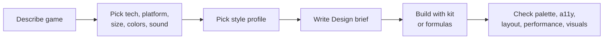

<div align="center">

# 🎮 Game UI Skill

**Ink outlines · thick block buttons · bright colors**

An open-source agent skill for designing game UI on web, mobile, desktop, and game engines.

[](CHANGELOG.md)
[](LICENSE)
[](https://github.com/maitrithanh/game-ui-skill)
[](https://github.com/maitrithanh/game-ui-skill/actions)

[English](#english) · [Tiếng Việt](#tiếng-việt)

</div>

---

## English

### Table of contents

- [Overview](#overview)
- [Features](#features)
- [Quick start](#quick-start)
- [Installation](#installation)
- [Activating the skill](#activating-the-skill)
- [Workflow](#workflow)
- [Style profiles](#style-profiles)
- [Web kit](#web-kit)
- [Validation tools](#validation-tools)
- [Design principles](#design-principles)
- [Repository layout](#repository-layout)
- [Releasing](#releasing)
- [Contributing](#contributing)
- [License](#license)

### Overview

`game-ui` defines the **interface identity and quality workflow** for game UI: ink-outlined objects, thick tactile buttons, bright semantic colors, responsive motion, and standards for accessibility, performance, code, and visual assets.

It does **not** decide the game, rules, technology, colors, or sound. Before building, the agent asks you for those choices and records them in a *Design brief*.

### Features

| | |
| --- | --- |
| 🧱 **Ready web kit** | Tokens, components, responsive layouts, modals, toasts, sound, haptics, storage, and game effects |
| 🧩 **Any technology** | HTML/JS, PWA, Electron, Tauri, Capacitor, React, Vue, Svelte, Angular, Next/Nuxt/SvelteKit |
| 📱 **Native & engines** | Token + formula guides for React Native, Flutter, SwiftUI, Compose, Unity, Godot |
| 📐 **Adaptive layouts** | Portrait mobile, landscape mobile, desktop, or automatic |
| 🎨 **6 style profiles** | Casual, storybook, arcade, cozy, mystical, tactical, with theme-driven art direction |
| 🧑‍🎤 **Characters, opt-in** | The agent asks before creating any; custom sets follow design rules with 12 expressions mapped to game states |
| ♿ **Accessible** | Semantic colors, contrast checks, hit areas, focus states, reduced motion |
| 🛠️ **Validation tools** | Palette checks, SVG rendering, palette previews, existing-code finder |

### Quick start

```bash
# 1. Install
npx skills add maitrithanh/game-ui-skill

# 2. Start a new agent session and ask:
#    "Use the game-ui skill to design the settings screen for my game."
```

### Installation

<details open>
<summary><b>Skills CLI (recommended)</b></summary>

```bash
npx skills add maitrithanh/game-ui-skill          # project
npx skills add maitrithanh/game-ui-skill -g -y    # global
npx skills update                                 # update after a release
```

Start a new agent session after updating so the old copy is not kept in context.

</details>

<details open>
<summary><b>One-command installer, per agent</b></summary>

Run from a project root. Without `--agent`, it installs into `.github/skills/game-ui/`.

| Agent | Command | Installs to |
| --- | --- | --- |
| 🟣 **Claude Code** | `curl -fsSL https://raw.githubusercontent.com/maitrithanh/game-ui-skill/main/install.sh \| sh -s -- --agent claude` | `~/.claude/skills` |
| 🐙 **GitHub Copilot** | `curl -fsSL https://raw.githubusercontent.com/maitrithanh/game-ui-skill/main/install.sh \| sh -s -- --agent copilot` | `~/.copilot/skills` |
| 🟢 **OpenAI Codex** | `curl -fsSL https://raw.githubusercontent.com/maitrithanh/game-ui-skill/main/install.sh \| sh -s -- --agent codex` | `~/.codex/skills` |
| 🔵 **Gemini CLI** | `curl -fsSL https://raw.githubusercontent.com/maitrithanh/game-ui-skill/main/install.sh \| sh -s -- --agent gemini` | `~/.gemini/skills` |
| ⚪ **Generic (`.agents`)** | `curl -fsSL https://raw.githubusercontent.com/maitrithanh/game-ui-skill/main/install.sh \| sh -s -- --agent agents` | `~/.agents/skills` |
| 📁 **Custom folder** | `curl -fsSL https://raw.githubusercontent.com/maitrithanh/game-ui-skill/main/install.sh \| sh -s -- --dir PATH` | `PATH` |

Copy-paste blocks:

```bash
# Claude Code
curl -fsSL https://raw.githubusercontent.com/maitrithanh/game-ui-skill/main/install.sh | sh -s -- --agent claude

# GitHub Copilot
curl -fsSL https://raw.githubusercontent.com/maitrithanh/game-ui-skill/main/install.sh | sh -s -- --agent copilot

# OpenAI Codex
curl -fsSL https://raw.githubusercontent.com/maitrithanh/game-ui-skill/main/install.sh | sh -s -- --agent codex

# Gemini CLI
curl -fsSL https://raw.githubusercontent.com/maitrithanh/game-ui-skill/main/install.sh | sh -s -- --agent gemini
```

</details>

<details>
<summary><b>Install from source with Make (per agent)</b></summary>

```bash
make install-agent                                # .agents/skills
make install-agent AGENT_DIR=.claude/skills       # Claude Code (project)
make install-agent AGENT_DIR=.github/skills       # GitHub Copilot (project)
make install-agent AGENT_DIR=.codex/skills        # OpenAI Codex (project)
make install-agent AGENT_DIR=.gemini/skills       # Gemini CLI (project)
```

</details>

<details>
<summary><b>Skill package (.skill)</b></summary>

Download `releases/game-ui.skill` and place it in your workspace's skills directory, or install it with your tool's skill-package mechanism. The archive contains `game-ui/` with `SKILL.md` as the entry point.

It is a ZIP file, so you can inspect it:

```bash
unzip -l releases/game-ui.skill
unzip -p releases/game-ui.skill '*/SKILL.md'
```

</details>

For web projects without an agent, copy `skills/game-ui/assets/` into your project. For native platforms or engines, use `skills/game-ui/references/` (tokens and formulas) instead of the web kit.

### Activating the skill

Installing makes the skill *available*; the agent loads it when your request matches the `description` in `SKILL.md`. To force it:

```text
/game-ui
```

or mention it: *"Use the game-ui skill to design the settings screen."*

For per-project use, install under `.github/skills/game-ui/` (Copilot), `.claude/skills/game-ui/` (Claude Code), or your agent's documented directory. The folder name and the frontmatter `name` must both be `game-ui`. The included `AGENTS.md` tells agents that support it when to use this skill.

### Workflow



1. Describe the game, rules, number of players, and required screens.
2. Choose technology, platform, preferred size, colors, and sound.
3. Choose a style profile (or accept one of two recommended directions).
4. The agent records everything as a **Design brief** before writing UI.
5. Build with the kit or the formulas matching your technology.
6. Verify palette, accessibility, responsive layout, performance, and visuals.

### Style profiles

Select one with `GameUI.init({ style: "..." })` or `GameUI.style("...")`. Full rules live in [`references/styles.md`](skills/game-ui/references/styles.md).

| Profile | Best for |
| --- | --- |
| **Ink Candy** *(default)* | Casual, party, trivia, family, children's games |
| **Storybook Paper** | Narrative, word, educational, chapter-based games |
| **Neon Arcade** | Action, rhythm, score-chasing, cyber, sports |
| **Cozy Workshop** | Building, cooking, farming, crafting, collecting |
| **Mystic Night** | Mystery, fantasy, exploration, investigation |
| **Field Manual** | Tactics, management, simulation, information-dense puzzles |

### Web kit

```html
<link rel="stylesheet" href="kit.css">
<script src="kit.js"></script>
<script>
  GameUI.init({
    id: "my-game",
    layout: "mobile",     // mobile | landscape | desktop | auto
    style: "ink-candy",   // see Style profiles (loads that style's font pair)
    sound: true,
    haptics: true,
    sky: true
  });
</script>
```

| `layout` | Use for |
| --- | --- |
| `mobile` | Portrait mobile |
| `landscape` | Landscape mobile |
| `desktop` | Desktop |
| `auto` | Both mobile and desktop |

`GameUI` also exposes `toast`, `sheet`, `confirm`, `show`, `reveal`, `confetti`, `celebrate`, `burst`, `avatar`, `meter`, `icon`, `store`, `sfx`, `buzz`, `settings`, `theme`, and DOM helpers (`$`, `$$`, `setText`, `setAttr`, `setPressed`). See [`assets/kit.js`](skills/game-ui/assets/kit.js) and the live [`demo/`](demo/index.html).

### Validation tools

Python 3, run from the skill directory:

```bash
python3 scripts/palette.py check path/to/file.css
python3 scripts/palette.py derive yellow=#f4c542
python3 scripts/preview_palettes.py
python3 scripts/render_check.py path/to/image.svg --out check.png
python3 scripts/find_existing.py button --project .
```

> A successful script run is not enough. Open rendered images and inspect them visually.

### Design principles

- Every object has an ink outline; depth comes from thick lips and hard shadows.
- One primary CTA and one clear task per screen.
- Keep action colors meaningful: green forward, yellow secondary, red destructive, blue safe.
- Avoid template purple gradients, glassmorphism, soft shadows as the main depth, and full-screen dark backgrounds.
- No emoji as system icons.
- Never communicate state by color alone; add text, an icon, or a check mark.
- Update locally, keep one source of truth for state, and reuse existing components.

### Repository layout

```text
.
├── skills/game-ui/          # marketplace skill source
│   ├── SKILL.md             # core rules, workflow, standards
│   ├── assets/              # kit.css, kit.js, template.html
│   ├── references/          # tokens.json, platforms, frameworks, palettes,
│   │                        # styles, code-standards, assets-quality
│   └── scripts/             # palette, preview, render, find_existing
├── demo/                    # landing page and browser demo
├── releases/                # installable .skill archives
├── .github/workflows/       # ci.yml, release.yml
├── install.sh               # one-command installer
├── AGENTS.md                # project-level agent instructions
├── CHANGELOG.md             # release notes
├── Makefile                 # build, validate, install
├── VERSION
└── LICENSE
```

### Releasing

GitHub Actions validates every PR and push to `main`, and publishes a GitHub Release when a version tag is pushed. Replace `X.Y.Z` with the new version.

```bash
printf 'X.Y.Z\n' > VERSION
# add a "## [X.Y.Z]" section to CHANGELOG.md
make release
git add VERSION CHANGELOG.md releases
git commit -m "chore: release vX.Y.Z"
git tag vX.Y.Z
git push origin main vX.Y.Z
```

The release workflow checks that the tag matches `VERSION`, builds the package, and uploads `game-ui-vX.Y.Z.skill`.

### Contributing

1. Keep changes focused on the relevant docs, tokens, kit, or scripts.
2. Don't copy an existing component just to make a similar one; extend it.
3. Run the palette, render, and accessibility checks that fit your change.
4. Update the reference docs and `CHANGELOG.md` when behavior or an API changes.

### License

[MIT](LICENSE). Keep the license notice when redistributing modified copies. Grandstander and Baloo 2 fonts are third-party assets under their own OFL licenses.

---

## Tiếng Việt

### Giới thiệu

`game-ui` là skill giao diện game mã nguồn mở cho web, mobile, desktop và game engine. Skill mang lại phong cách **viền mực**, **nút khối dày**, màu tươi, chuyển động có phản hồi, cùng tiêu chuẩn về accessibility, hiệu năng, code và hình ảnh.

Skill **không** tự quyết định game, luật chơi, công nghệ, kích thước, màu sắc hay âm thanh. Trước khi dựng UI, agent sẽ hỏi bạn các lựa chọn đó và ghi vào “Phiếu thiết kế”.

### Tính năng

- Hỗ trợ HTML/JS, PWA, Electron, Tauri, Capacitor, React, Vue, Svelte, Angular, Next/Nuxt/SvelteKit.
- Công thức cho React Native, Flutter, SwiftUI, Compose, Unity, Godot.
- Kit web dùng ngay: token, component, layout responsive, modal, toast, âm thanh, haptics, lưu trữ, hiệu ứng.
- Bố cục mobile dọc, mobile ngang, desktop hoặc tự thích ứng.
- **6 style profile**: Ink Candy, Storybook Paper, Neon Arcade, Cozy Workshop, Mystic Night, Field Manual.
- Màu ngữ nghĩa, độ tương phản, vùng chạm, focus, giảm chuyển động.
- Công cụ kiểm tra palette, render SVG, xem trước palette, tìm code có sẵn.

### Cài đặt nhanh

```bash
npx skills add maitrithanh/game-ui-skill          # cài vào project
npx skills add maitrithanh/game-ui-skill -g -y    # cài global
npx skills update                                 # cập nhật khi có bản mới
```

Sau khi cập nhật, mở session agent mới để không dùng bản skill cũ.

Cài bằng một lệnh (vào `.github/skills/game-ui/`):

```bash
curl -fsSL https://raw.githubusercontent.com/maitrithanh/game-ui-skill/main/install.sh | sh
```

Cài cho từng agent:

| Agent | Lệnh |
| --- | --- |
| 🟣 Claude Code | `... \| sh -s -- --agent claude` |
| 🐙 GitHub Copilot | `... \| sh -s -- --agent copilot` |
| 🟢 OpenAI Codex | `... \| sh -s -- --agent codex` |
| 🔵 Gemini CLI | `... \| sh -s -- --agent gemini` |
| ⚪ Generic | `... \| sh -s -- --agent agents` |
| 📁 Thư mục riêng | `... \| sh -s -- --dir PATH` |

(`...` = `curl -fsSL https://raw.githubusercontent.com/maitrithanh/game-ui-skill/main/install.sh`)

Cài thủ công từ file `.skill`:

```bash
mkdir -p .github/skills
unzip -oq releases/game-ui.skill -d .github/skills
```

Entry point sau khi giải nén: `.github/skills/game-ui/SKILL.md`.

### Kích hoạt skill

Cài skill chỉ làm skill *sẵn sàng*; agent tự nạp khi yêu cầu khớp `description` trong `SKILL.md`. Gọi trực tiếp bằng `/game-ui` hoặc ghi rõ:

```text
Hãy dùng skill game-ui để thiết kế màn hình cài đặt cho game của tôi.
```

### Quy trình sử dụng

1. Mô tả game, luật chơi, số người chơi và các màn hình cần có.
2. Chọn công nghệ, nền tảng, kích thước ưu tiên, màu sắc và âm thanh.
3. Chọn style profile phù hợp.
4. Ghi lại thành “Phiếu thiết kế” trước khi viết UI.
5. Dùng kit hoặc công thức đúng với công nghệ đã chọn.
6. Kiểm tra palette, accessibility, responsive, hiệu năng và hình ảnh trước khi giao.

### Ví dụ khởi tạo web

```html
<link rel="stylesheet" href="kit.css">
<script src="kit.js"></script>
<script>
  GameUI.init({
    id: "ten-game",
    layout: "mobile",     // mobile | landscape | desktop | auto
    style: "ink-candy",
    sound: true,
    haptics: true,
    sky: true
  });
</script>
```

Mobile dọc dùng `mobile`, mobile ngang dùng `landscape`, desktop dùng `desktop`, cả hai dùng `auto`.

### Cấu trúc repository

- `skills/game-ui/`: source skill (`SKILL.md`, `assets/`, `references/`, `scripts/`).
- `demo/`: landing page và demo trên trình duyệt.
- `releases/`: package `.skill` để cài đặt.
- `CHANGELOG.md`: lịch sử thay đổi theo version.
- `install.sh`: script cài bản mới nhất bằng một lệnh.
- `AGENTS.md`: hướng dẫn agent cấp project.

### Phát hành

Cập nhật `VERSION`, thêm mục `## [X.Y.Z]` vào `CHANGELOG.md`, rồi:

```bash
make release
git add VERSION CHANGELOG.md releases
git commit -m "chore: release vX.Y.Z"
git tag vX.Y.Z
git push origin main vX.Y.Z
```

Workflow kiểm tra tag khớp `VERSION`, build và đính kèm `game-ui-vX.Y.Z.skill` vào GitHub Release.

### Giấy phép

[MIT License](LICENSE). Font Grandstander và Baloo 2 là tài sản bên thứ ba, phân phối theo giấy phép OFL tương ứng.
